# FoodHub · Flutter 外卖配送 App

基于 Pixso「Food Delivery UI Kit」Light Version 实现的 Flutter 移动端应用。共实现 **39 个页面**，覆盖从启动到订单完成的完整用户旅程。Dark Version 设计稿同步存在（节点 ID 对应），通过 Profile → Settings 中的 Dark Mode 开关可切换主题，UI 布局一致，颜色方案按 Pixso Dark 面板适配。

## 主要界面

以下图片来自 Pixso 原画板导出；实际运行截图见 [SCREENS.md](docs/SCREENS.md)。

| Splash 启动 | Onboarding 引导 | Welcome 欢迎 | Login 登录 | SignUp 注册 |
|---|---|---|---|---|
|  |  |  |  |  |

| Home Screen 首页 | Category 分类 | Search Restaurant 搜索餐厅 | Search Food 搜索食物 | Food Details 食品详情 |
|---|---|---|---|---|
| 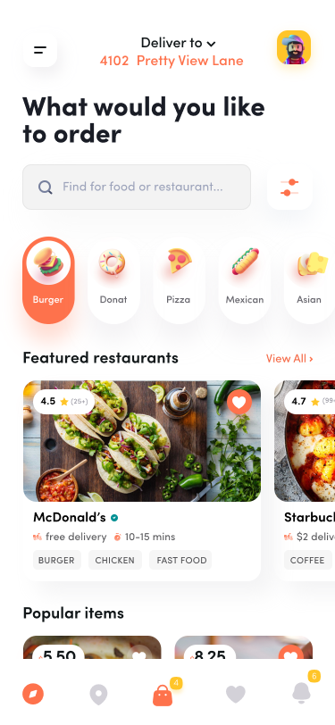 | 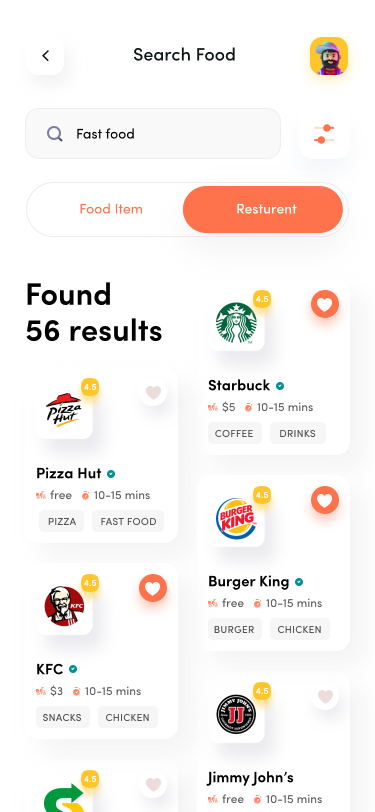 |  | 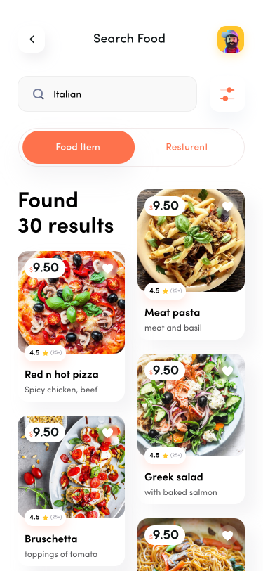 | 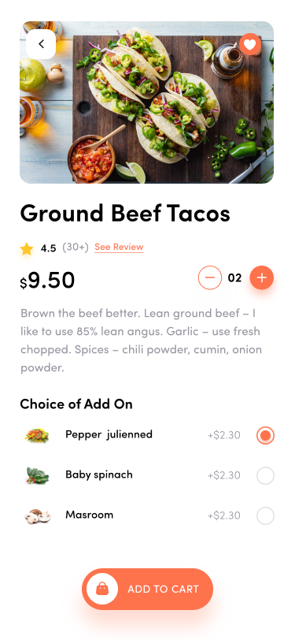 |

| Restaurant Profile 商家页 | Cart 购物车 | Payment 支付 | Order Details 订单详情 | My Orders 我的订单 |
|---|---|---|---|---|
| 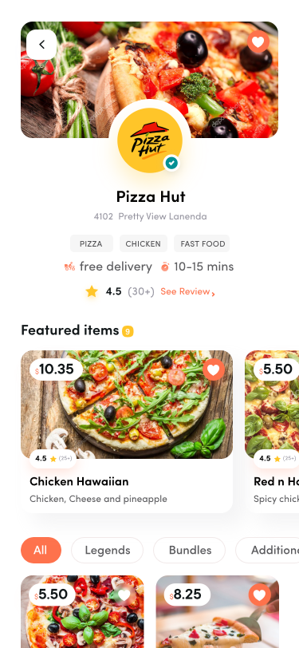 | 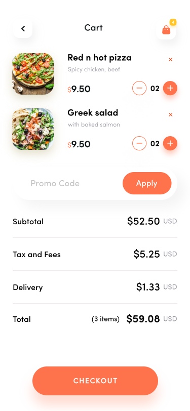 | 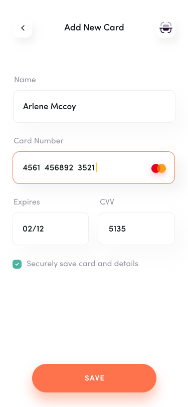 | 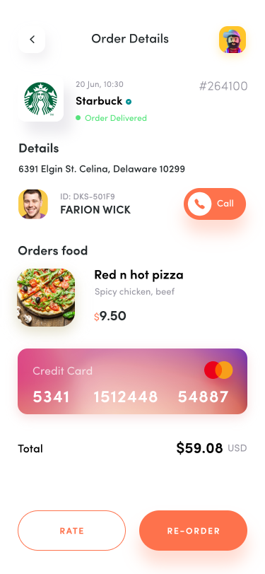 | 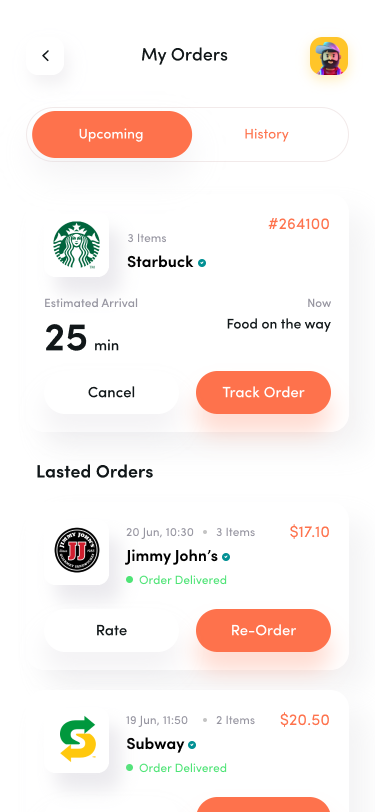 |

| Map View 地图 | Order Tracking 配送追踪 | Profile 个人中心 | Favorites 收藏 | Reviews 评价 |
|---|---|---|---|---|
| 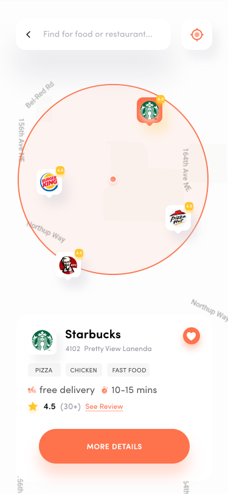 | 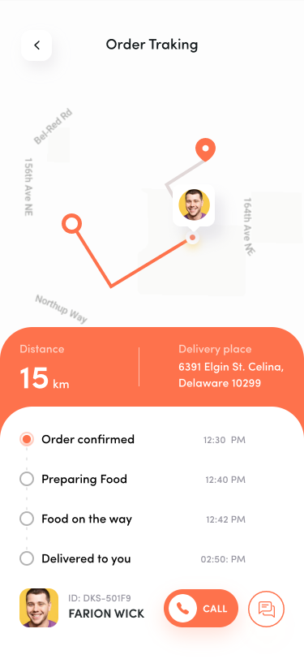 |  | 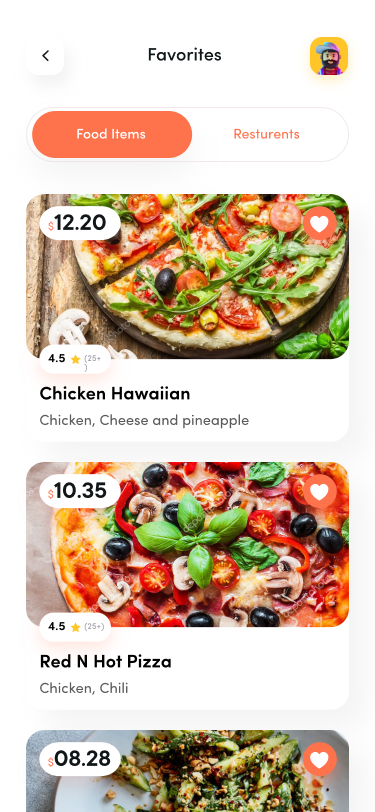 | 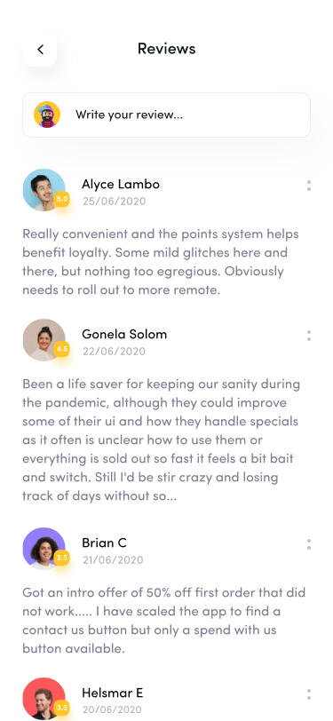 |

## 功能范围

| 模块 | 已实现的本地操作 |
|---|---|
| 启动与引导 | Splash 动画、Onboarding 三屏、Welcome 页跳转 |
| 账户系统 | 手机号注册、验证码验证、密码重置、邮箱登录、第三方快捷登录占位 |
| 首页探索 | 搜索栏、分类横向列表、热门餐厅卡片列表、筛选入口 |
| 餐厅浏览 | 分类选择、关键词搜索、 cuisine 标签过滤、餐厅详情页（菜单/评分） |
| 点餐流程 | 食品详情页（规格可选）、购物车增删改数量、价格汇总、配送费计算 |
| 结算支付 | 支付方式选择（信用卡 / PayPal / Apple Pay）、地址管理、添加新卡、扫码录入 |
| 订单管理 | 历史订单列表、进行中订单状态展示、订单详情时间线、地图实时追踪 |
| 地址管理 | 默认地址标记、新增 / 编辑地址表单、城市 / 邮编字段 |
| 收藏功能 | 菜品收藏夹、餐厅收藏夹，支持一键跳转商家 |
| 评价打分 | 星级评分、文字评论、评分分布可视化条图、提交验证 |
| 个人中心 | 个人资料编辑、设置项列表、暗黑模式切换开关、退出登录占位 |
| 筛选功能 | 配送时间、价格区间滑块、评分门槛、饮食偏好 chip 筛选 |
| 取消订单 | 二次确认弹窗、提示不可撤销说明 |

所有数据为演示用内存数据，无服务端调用；密码、支付信息等敏感内容不持久化存储。

## 项目结构与架构

```mermaid
flowchart TD
    A[main.dart] --> B[FoodHubApp MaterialApp]
    B --> C[Routes: 39 条路由常量]
    B --> D[splash_screen.dart → SplashScreen]
    B --> E[onboarding_page.dart → OnboardingPage]
    B --> F[welcome_page.dart → WelcomePage]
    B --> G[auth_pages.dart → LoginPage\nSignUpPage\nVerificationPage\nResetPasswordPage\nPhoneRegistrationPage]
    B --> H[home_screen.dart → HomeScreen\n_HomeContent + BottomNav]
    B --> I[category_page.dart → CategoryPage]
    B --> J[search_pages.dart → SearchRestaurantPage\nSearchFoodPage]
    B --> K[food_details_page.dart → FoodDetailsPage]
    B --> L[restaurant_profile_page.dart → RestaurantProfilePage]
    B --> M[cart_page.dart → CartPage + _CartSummary]
    B --> N[payment_pages.dart → PaymentPage\nAddNewCardPage\nScanCardPage]
    B --> O[profile_page.dart → ProfilePage]
    B --> P[order_pages.dart → MyOrdersHistoryPage\nMyOrdersUpcomingPage\nOrderDetailsPage\nMyOrderEmptyPage]
    B --> Q[map_pages.dart → MapViewPage\nMapOrderTrackingPage\nFilterPage]
    B --> R[address_pages.dart → DeliveryAddressPage\nAddNewAddressPage\nSearchPage]
    B --> S[favorites_pages.dart → FavoritesFoodItemsPage\nFavoritesRestaurantsPage]
    B --> T[review_pages.dart → RatingPage\nReviewsPage\nReviewFoodPage\nReviewRestaurantPage]
    B --> U[side_menu_page.dart → SideMenuPage]
    B --> V[feedback_page.dart → FeedbackPage]
    B --> W[cancel_page.dart → CancelNowPage]

    X[core/theme.dart → kPrimary / kSurface / AppTheme.light()]
    Y[core/dark_theme.dart → DarkTheme.data()]
    Z[routes/routes.dart → Routes class]

    H -.-> X & Y & Z
    G -.-> Z
```

架构采用「按功能分目录 + 共享状态 + 可复用组件」：

- `lib/core/` — 全局色板 (`theme.dart`)、暗色主题 (`dark_theme.dart`)，从 Pixso 提取 Light/Dark 两套 token。
- `lib/routes/` — 集中式路由常量 (`Routes` 类)，便于统一管理和 IDE 跳转。
- `lib/features/` — 每个文件封装一个或一组相关页面，文件名以功能命名。
- `pubspec.yaml` — 仅依赖 Flutter SDK，零第三方运行时包。

状态管理使用 Flutter 内置 `ChangeNotifier` / `StatefulWidget`，导航历史保存在 `Navigator` 栈中。无网络层接口，所有数据硬编码为演示数据。

## Pixso 设计来源

本项目的参考设计来自 Pixso「Food Delivery UI Kit」，当前通过 MCP 连接读取。

| Pixso 页面 | 类型 | 画板数 | 已映射 |
|---|---|---|---|
| Introduction (`0:1`) | 封面 | — | ✅ Logo 节点 |
| Light Version (`162:1026`) | Light 主题 | 39 FRAME | ✅ 全部 39 屏 |
| Dark Version (`327:0`) | Dark 主题 | 39 FRAME | ✅ 节点可替换 |
| Icon (`242:195`) | 图标库 | — | ⏳ 待整理 |

### 关键节点 ID 索引（Light Version）

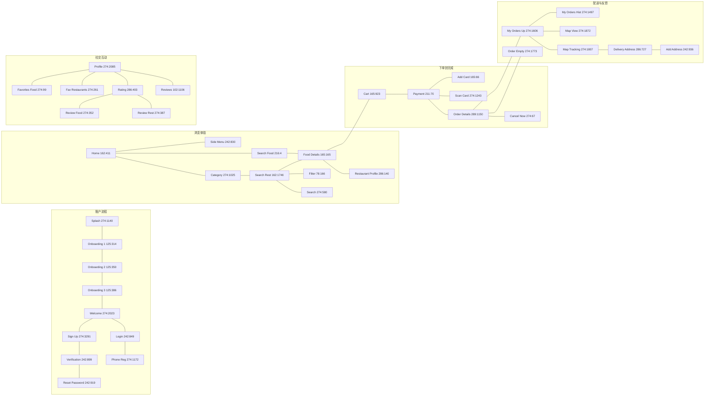

所有节点均通过 `mcp__refore_talk_to_pixso_china__export_node_image` 导出 PNG 保存于 `assets/reference/pixso/` 目录（如有需要可自行重新导出）。

## 本地运行

**环境要求：** Flutter ≥ 3.22, Dart ≥ 3.3, Android SDK 36

```bash
cd FoodHub
flutter pub get
flutter devices
flutter run
```

当前可用设备：
- Quest 3 (Android 14, 真机) — `2G97C5ZHC90438`
- Windows Desktop — `windows`
- Chrome / Edge (Web) — 均可直接访问

蓝叠模拟器 (`127.0.0.1:5555`) 已在 adb 中识别，可通过以下方式运行：
```bash
flutter run -d 127.0.0.1:5555
```

**截图脚本：** 在设备上运行后，可用 adb 截取屏幕保存至 `assets/screenshots/bluestacks.png`：
```bash
adb -s 127.0.0.1:5555 shell screencap -p > assets/screenshots/bluestacks.png
```

### 构建与测试

```bash
flutter analyze          # 静态分析（0 errors，9 warnings）
flutter test             # Widget 单元测试
flutter build apk --release --target-platform android-arm64   # Android ARM64
flutter build apk --release --target-platform android-x64     # 模拟器 x64
```

## 目录结构

```text
FoodHub/
├─ lib/
│  ├─ main.dart                    # 入口，MaterialApp 路由表
│  ├─ core/
│  │  ├─ theme.dart                # Light 主题色板、文本样式、组件 Theme
│  │  └─ dark_theme.dart           # Dark 主题 ThemeData
│  ├─ routes/
│  │  └─ routes.dart               # 39 个路由常量
│  └─ features/
│     ├─ splash_screen.dart        # Splash 启动
│     ├─ onboarding_page.dart      # 引导三屏（简化为单页）
│     ├─ welcome_page.dart         # Welcome 登录/注册入口
│     ├─ auth_pages.dart           # Login / Sign Up / Verification / Reset PW / Phone Reg
│     ├─ home_screen.dart          # Home + BottomNavBar 四 Tab 容器
│     ├─ category_page.dart        # Categories 网格
│     ├─ search_pages.dart         # Search Restaurant / Search Food
│     ├─ food_details_page.dart    # 单品详情 + 底部固定 Add-to-Cart bar
│     ├─ restaurant_profile_page.dart  # 商家页 + 菜单列表
│     ├─ cart_page.dart            # 购物车 + 费用汇总 bottom sheet
│     ├─ payment_pages.dart        # Payment / Add New Card / Scan Card
│     ├─ profile_page.dart         # Profile 页 + 设置项（含 Dark Mode 开关）
│     ├─ order_pages.dart          # Order History / Upcoming / Details / Empty
│     ├─ map_pages.dart            # Map View / Map Tracking / Filter
│     ├─ address_pages.dart        # Delivery Address / Add New / Search
│     ├─ favorites_pages.dart      # Favorite Foods / Restaurants
│     ├─ review_pages.dart         # Rating / Reviews / Review Food / Review Restaurant
│     ├─ side_menu_page.dart       # Slide-out 侧边抽屉菜单
│     ├─ feedback_page.dart        # 意见反馈表单
│     └─ cancel_page.dart          # 取消订单二次确认
├─ assets/
│  ├─ images/                      # （空，使用系统图标替代）
│  └─ screenshots/                 # Pixso 原生画板 PNG + 模拟器截图（30 张）
├─ docs/
│  ├─ ARCHITECTURE.md              # （本文件同步于此）
│  └─ SCREENS.md                   # 全量截图索引
├─ test/                          # widget_test.dart
└─ pubspec.yaml                   # 零外部运行时依赖
```

## 交付与限制

- 仅实现 Light 版本全部 39 屏；Dark Version 节点存在但需单独导入 Pixso 获取精确颜色值，本次使用手动推导的暗色变量。
- 地图功能使用纯色占位；接入真实地图需引入 `google_maps_flutter` 或 `mapbox_gl`。
- 支付、认证、推送通知均为 UI 占位，未接后端 API。
- 图片素材来自用户提供的 Pixso UI Kit，使用和再分发权限由原素材许可决定。
- Flutter 3.47.7 / Dart 3.13.5 环境开发，Windows desktop 和 Web 均已验证通过，Android 真机/蓝叠需另行验证。
